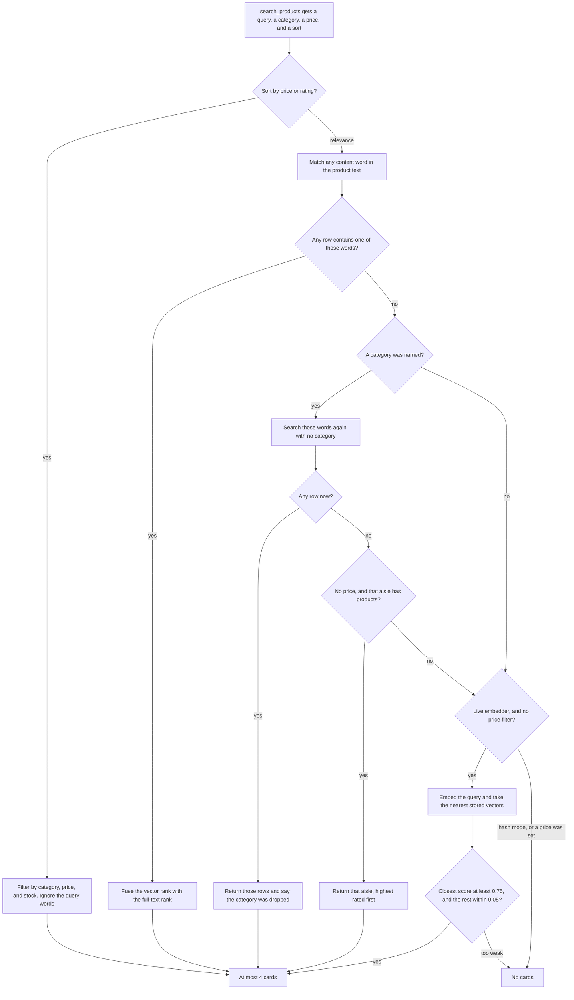
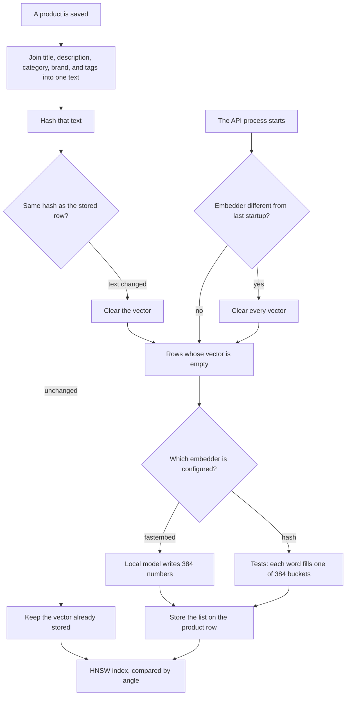

# Shopping copilot

A local shop assistant. You type a request, the server searches a Postgres catalog, and the reply streams back with product cards. A worker refreshes that catalog from a remote source. The chat itself never calls the remote source.

The same walkthrough, with the diagrams, is the [How it works](http://localhost:5173/guide) page. The chat header links to it. When the API serves the built app, that page is [http://localhost:8000/guide](http://localhost:8000/guide).

## What happens when you ask

1. The browser sends your message to the API and keeps the connection open for a stream.
2. The Decisions API reads the last six messages and picks one route: search, clarify, off-catalog, or chat. It does not pick keywords or a price. If the route is search and the chance that a product or a place was named is under 0.5, the server treats the turn as clarify. A route outside those four names also becomes clarify.
3. Search and clarify call `search_products` before the written answer. On a search turn the model may then call `search_products` again, or `list_categories`, which returns category names. Clarify may search once, and then the tools are taken away. Off-catalog and chat get no tools.
4. The tool reads Postgres. With the live model, Decisions scores each returned product and drops one under 0.5 before any card is sent. If none remain, the tool says none of the products answer the question. `FAKE_LLM=1` skips that score and keeps the search result.
5. The stream sends a status, then the cards, then the answer tokens, then done. The prompt tells the model to name a product only when the tool returned it. The sentence is not scanned. Reloading rebuilds the cards from ids that appear in the tool result.

| You say | Route | What you get |
| --- | --- | --- |
| A phone under 500 | search | Phone cards at or below 500, and a top pick |
| Something for the living room | search | The live model is asked to search home decoration. The scripted model sends the whole sentence and does not set that category |
| Something cheap and cool | clarify | A search, then one question that names real categories and prices |
| A flight to Tokyo | off-catalog | No cards. A sentence about what the store sells |
| Thanks | chat | A short reply and no products |
| A laptop and a watch | search | Two searches and two groups of cards |
| The cheaper one | search, same chat | The earlier cards stay in the thread. A new search can sort by price and ignores the query words. The scripted model returns the cheapest in-stock products |

With `FAKE_LLM=1` a phrase table makes the same four-way choice and does not apply the 0.5 check. No API key is required.

## The pieces

The browser is a React app. In development, Vite serves it at http://localhost:5173 and proxies `/api` to the API. In the Docker image, FastAPI serves the built page itself, and there is no Node process.

The API is FastAPI. When the process starts it builds one agent and reuses that object for every message. The chat model is chosen then, from `FAKE_LLM`, so switching between the scripted model and `gpt-6-luna` means restarting the process. The route check and the product review read `FAKE_LLM` again on each turn. With the live model, a thread past 6000 tokens is summarized and the last 12 messages are kept.

The agent is a LangChain graph. Middleware chooses the route and then limits the tools:

- search and clarify must call `search_products` before the written answer
- after that first search, a search turn may call `search_products` again or `list_categories`
- clarify gets no tools once `search_products` has returned
- off-catalog and chat get no tools
- when the thread is read back, a card whose id is missing from the tool result is left out

`gpt-6-luna` writes the reply and chooses the search arguments. The Decisions API chooses the route, and with the live model it also scores each product the search returned. A larger catalog is another column or another tool, not a second orchestrator.

Postgres holds the products, the vectors, and the chats. In Celery mode Redis is the queue and the lock for the copy job. With `SYNC_MODE=inprocess` and `AUTO_SYNC=1` the API runs that job on a timer, and Redis is not required.

## How a search chooses products

`search_products` takes a query, optional categories, an optional price range, and a sort. Out-of-stock rows are excluded. A group is cut to four cards. A sort of `price_asc`, `price_desc`, or `rating` skips the words and the vectors. It filters by category, price, and stock. If that category returns nothing, the search runs again without the category. The query words are ignored on this path.

Relevance search matches words first. One content word is enough. Words shorter than three letters are dropped, along with a stop list that includes “under” and “something.” A repeated letter is folded, so “phhone” is also searched as “phone.” The match is a case-insensitive substring of the title, the description, the category, or the joined text that holds the brand and the tags.



When the words hit, the order comes from reciprocal rank fusion of the vector ranking and the full-text ranking, over a wider candidate set, then limited to the word-match ids. Word matches that fusion missed are appended. The query is embedded with the same model that wrote the product vectors. The neighbor score is 1 minus the cosine distance: 1 is the same direction, and 0 is unrelated. That score is used only in the neighbor step. Fusion uses the ranks, not this score.

If the words miss inside a named category, the same words are tried with the category removed. A hit returns those rows and says the category was dropped. The aisle runs when that second try also misses, a category was named, and no price was set. Those products come back highest rated first, and the reply says so. Vectors are not used for that aisle.

The neighbor step runs only when the words missed, no aisle was returned, `EMBED_MODE=fastembed`, and no price was set. The closest row must score at least 0.75, and any other row must sit within 0.05 of that score. Short product texts sit close together, so a vague phrase can fall under 0.75 and leave the card list empty. The model can then ask a question from the catalog facts. The useful search is a category the model passes, such as `home-decoration`, or a product word such as “lamp.” The live model is asked to pass that category for a place. The scripted model does not. Hash mode never takes the neighbor step, so a miss in the tests stays empty. A price such as “under 500” is a filter on the word search. It does not unlock the neighbor step.

Every search result also includes catalog facts: each in-stock category, that category’s price span, the overall price range, and the highest-rated item. Clarify uses those facts to ask one question. “Cheap” and “cool” are not turned into a price. A price is applied only when you name one.

The table is indexed for those lookups. Category, price, rating, availability, and brand are btree indexes. Tags and the full-text column are GIN indexes. The embedding column is an HNSW index on cosine distance.

## How the catalog stays current

The copy reads every page of the remote catalog into Postgres. It does not ask only for products newer than the newest row already stored, so a partial table is filled in on the next run. Each saved product is embedded. A product whose text is unchanged keeps the vector it already has. The API runs that copy at startup, and on its own timer, when `AUTO_SYNC=1`. With `SYNC_MODE=inprocess` that timer is inside the API process and Redis is not required. Celery beat schedules the same full copy from `SYNC_INTERVAL_MINUTES`, which defaults to 60, and it does not read `AUTO_SYNC`. Once a day at 03:00, Celery also reads the remote category list. The in-process scheduler does not. The chat does not get faster or slower because of the interval. It only gets staler between copies. In Celery mode Redis holds the queue and a lock named `catalog_sync_lock`. If Redis is down, that copy is skipped, chat still answers from the current table, and health reports sync as unavailable.

An embedding is a list of numbers that stands in for one product’s text. Texts with a similar meaning point in a similar direction, which is what lets a later search compare a question with a product. The chat model does not build these lists. A model on this machine does, and the lists stay in the `embedding` column.



The joined text is hashed with SHA-256 and stored as `embed_hash`. The same hash means the title, description, category, brand, and tags did not change, so the stored vector is left in place. Review comments stay on the row and are left out of this text. A new hash clears that row’s vector. Startup fills every empty vector. If `EMBED_MODE` differs from the mode recorded in `catalog_meta`, startup clears every vector first, writes them again, and rebuilds the HNSW index, because lists from two embedders cannot be compared.

`EMBED_MODE=fastembed` uses `BAAI/bge-small-en-v1.5` locally. Each list is 384 numbers. `EMBED_MODE=hash` is what the tests use, so they do not download the model. Each word is counted into one of 384 positions and the list is scaled to length 1. Identical words land together. Related words do not. Both lists are stored in the same column, and that column has the HNSW index. Hash mode does not take the neighbor step. The fastembed model is English, so a query in another language ranks poorly.

## What a chat remembers

The sidebar reads a `conversations` table: id, title, and timestamps. The title is the first message, cut at 60 characters. The same title is listed once, as the newest chat. Asking that question again from the empty home page opens the existing chat and does not send the message. Inside a chat, the same text is a new turn. Delete removes every conversation with that title, including rows the sidebar is hiding.

The messages, tool results, and cards live in LangGraph checkpoints for that conversation. `GET /api/conversations/{id}/messages` reads them back and leaves out a card whose id is not in a tool result. With the live model, `SummarizationMiddleware` summarizes the thread after 6000 tokens and keeps the last 12 messages. The scripted model does not.

The stream is a task that is not tied to the browser connection. Each turn emits a status, then one event per card group, then one event per answer token, then done. An error is its own event. Cards are emitted by the tool before the model writes the answer.

- Reload mid-stream: the task finishes. The next load shows the completed turn.
- Stop: the task is cancelled. The user message and any tool results already saved stay, and the partial reply is marked incomplete. It is not resumed.
- Delete: the sidebar rows for that title go away. Checkpoints are not tied to those rows, so a delete after the run has started does not erase a turn already in progress.
- Postgres down: the turn returns an error. Checkpoints already written stay where they are.
- The data volume deleted: the product table is empty and health says the catalog is loading. On the next API start with `AUTO_SYNC=1`, a sync is enqueued. Conversations go away with the volume.

## Setup

```bash
cp .env.example .env
docker compose up --build
```

That starts Postgres, Redis, the API on http://localhost:8000, a Celery worker, and Celery beat. Put `OPENAI_API_KEY` in `.env` and set `FAKE_LLM=0` for `gpt-6-luna`. Leave `FAKE_LLM=1` to run with no key. The key stays in `.env`. The assignment mail is gitignored with the rest of `assignment/`.

For development, start the database and Redis, then:

```bash
SYNC_MODE=inprocess uvicorn api.main:app --reload --port 8000
cd web && npm run dev
```

The in-process timer and the startup copy also need `AUTO_SYNC=1`. `.env.example` sets that.

`make test` runs pytest, Vitest, and Playwright against the 14-product fixture in the `shop_test` database. The catalog you chat with stays in `shop`.

## Why the agent is shaped this way

The catalog is the part that will grow, so the model is not the place where product data lives. Typed tools keep a new filter or a second source as a column or a tool. The thread lives in one checkpoint, the route is a closed choice, and the page is a static client in front of a Python server.

## Evaluation

`make test` has three layers.

Pytest, with `FAKE_LLM=1`, walks a sentence through the tool to the cards. It covers paging and idempotent sync, price ceilings, an empty filter that stays empty, a review-only word that stays unmatched, catalog facts, an unknown category, one shared agent, two groups for two intents, off-catalog with no cards, clarify with a question drawn from the categories, a follow-up, SSE event order, a closed client that still leaves a complete checkpoint, and a product review that drops a weak match for the live model while the scripted model keeps the search result. `pytest -m eval` repeats the phone trajectory offline. `EVAL_LIVE=1` runs it against `gpt-6-luna` and is skipped otherwise.

Vitest checks the card, the stream accumulator, the empty shell at `/` and `/c/abc`, and the guide headings plus the three diagrams.

Playwright opens two chats and reloads, asks for a phone and sees the card after reload, sees the reply text with the cards, sees no cards for a flight, sees a catalog question for “something cheap and cool,” and opens the guide from the header.

The suite does not catch embedding drift when the model file changes, pixel-level layout, or shopper wording outside the reference prompts. The fake model follows a script. A live model can pick different arguments and still be reasonable. The offline suite will not call that a pass unless the script matches.
